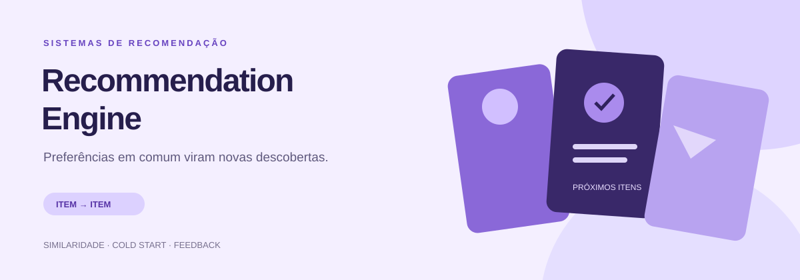
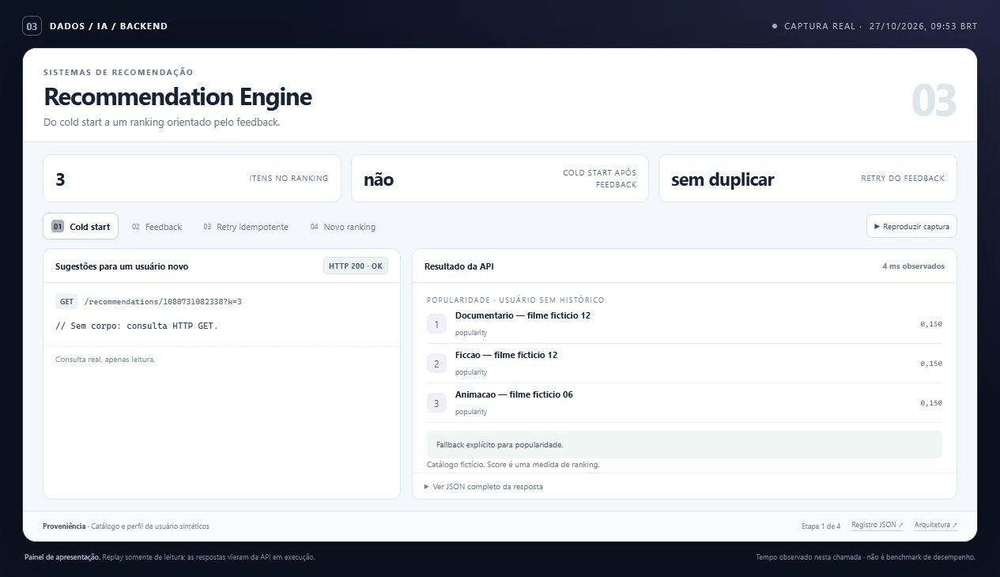
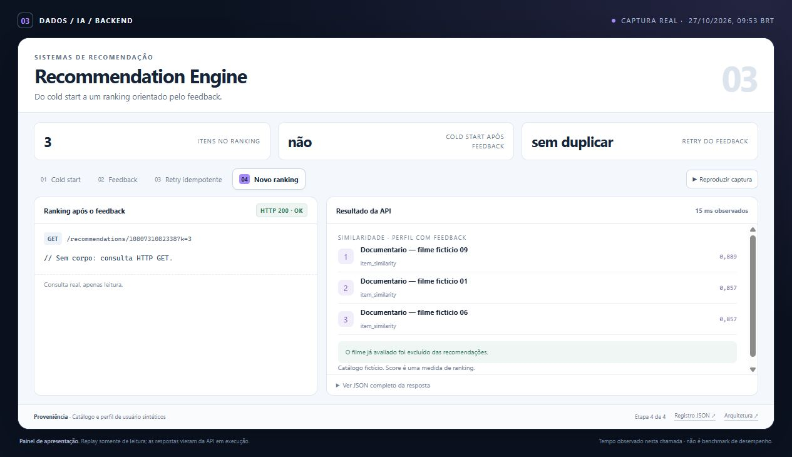
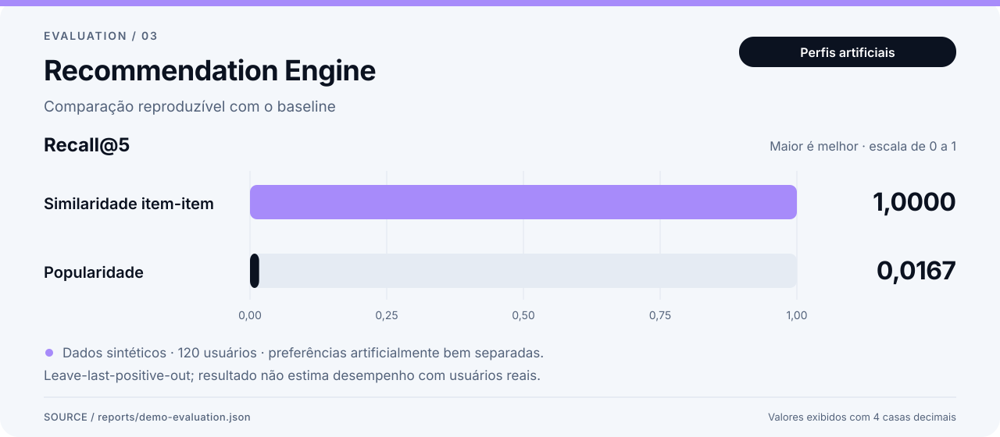
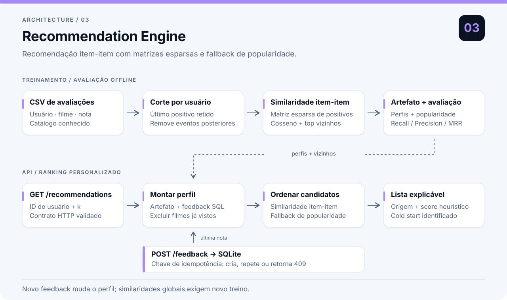

# Recommendation Engine

Uma API de recomendações que parte do histórico de avaliações para encontrar filmes ainda não vistos. Ela combina similaridade entre itens, um fallback para usuários sem histórico e feedback persistente.

A técnica é a **filtragem colaborativa item-item**: o modelo calcula a similaridade entre filmes a partir dos padrões de avaliação e usa essas relações para montar o ranking.

**Histórico positivo → filmes semelhantes → exclusão dos já avaliados → ranking**

A demonstração usa **120 usuários e 72 filmes fictícios**. Python, FastAPI, SciPy e SQLite compõem o pipeline.

## Como a recomendação funciona

1. Avaliações a partir de quatro estrelas viram sinais positivos binários.
2. A matriz esparsa relaciona filmes a usuários. A similaridade de cosseno encontra vizinhos de cada filme.
3. Na consulta, os vizinhos dos filmes positivos do usuário acumulam pontos. Todos os filmes já avaliados são excluídos, inclusive avaliações negativas.
4. Se faltarem candidatos, a lista é completada pela quantidade de usuários que avaliaram bem cada filme, com desempate estável pelo ID.

Um usuário novo recebe popularidade com `cold_start=true`. Novo feedback altera o perfil usado na consulta, mas **não recalcula** as similaridades globais nem a popularidade do artefato. Para incorporar esse sinal ao modelo global, é preciso exportar/incorporar o histórico de feedback ao dataset e treinar uma nova versão. Não há retreinamento automático escondido no endpoint.

O treinamento retém apenas os vizinhos mais próximos de cada item; não persiste uma matriz densa de similaridade do catálogo inteiro. A busca exata ainda tem custo alto conforme o catálogo cresce. Catálogos muito maiores pediriam outra estratégia de candidatos ou busca aproximada.

## Do histórico ao ranking

Na sequência abaixo, a API consulta recomendações, recebe uma avaliação e atualiza o perfil usado na próxima consulta. Os filmes e usuários são fictícios.



[Abrir o painel](docs/demo/index.html) · [Solicitações e respostas](docs/demo/run.json) · [Captura do Swagger](docs/assets/api-docs.jpg)

<details><summary>Ver captura estática</summary>



</details>

## Rodar localmente

Requer Python 3.11 ou superior. Execute os comandos dentro desta pasta, em um terminal PowerShell:

```powershell
python -m venv .venv
.\.venv\Scripts\python.exe -m pip install -c requirements.lock -e ".[dev]"
.\.venv\Scripts\python.exe -m recommendation_engine demo
.\.venv\Scripts\python.exe -m uvicorn recommendation_engine.api:app --port 8003
```

No Linux/macOS, use `.venv/bin/python` no lugar de `.\.venv\Scripts\python.exe`.

`requirements.lock` registra as versões de runtime e desenvolvimento usadas na validação com Python 3.11. O `pyproject.toml` mantém os intervalos aceitos pelo pacote.

O comando `demo` avalia o modelo usando os dados sintéticos incluídos e treina um artefato separado para servir a API. Os resultados e o artefato ficam em `var/`, que não entra no Git.

Abra a documentação interativa em [localhost:8003/docs](http://localhost:8003/docs). A aplicação devolve `503` quando não encontra o modelo; o startup não dispara treinamento.

### Experimentar a API

Em outro PowerShell:

```powershell
Invoke-RestMethod 'http://localhost:8003/health'
Invoke-RestMethod 'http://localhost:8003/recommendations/1?k=5' |
  ConvertTo-Json -Depth 5

$body = @{ user_id = 999; movie_id = 1; rating = 5.0 } | ConvertTo-Json
Invoke-RestMethod -Method Post 'http://localhost:8003/feedback' `
  -ContentType 'application/json' `
  -Headers @{ 'Idempotency-Key' = 'demo-user999-movie1-v1' } -Body $body

Invoke-RestMethod 'http://localhost:8003/recommendations/999?k=5' |
  ConvertTo-Json -Depth 5
```

Em um banco de feedback novo, o usuário `999` começa sem histórico. Depois do feedback, o filme `1` entra no seu perfil e é excluído das recomendações. Reenviar a mesma chave com o mesmo corpo retorna o mesmo evento (`200`); reutilizá-la com outro corpo retorna `409`. Uma nova avaliação intencional exige uma nova chave.

| Endpoint | Comportamento |
| --- | --- |
| `GET /health` | Readiness, versão do modelo e metadados do treinamento |
| `GET /recommendations/{user_id}?k=10` | Lista de até 50 filmes, motivo e origem de cada sugestão |
| `POST /feedback` | Avaliação de 0,5 a 5, em passos de 0,5; exige `Idempotency-Key` |

Cada item informa `source=item_similarity` ou `source=popularity`. O `score` é uma heurística de ranking, não uma probabilidade; os dois tipos de score têm significados diferentes. Os itens de popularidade completam a lista depois dos candidatos colaborativos.

## Avaliação e resultados



Recall@5 no cenário sintético de preferências bem separadas; há um item relevante retido por usuário.

```powershell
.\.venv\Scripts\python.exe -m recommendation_engine evaluate --output var/evaluation.json
.\.venv\Scripts\python.exe -m recommendation_engine train --neighbors 30
.\.venv\Scripts\python.exe -m recommendation_engine recommend --user-id 1 --k 5
```

O protocolo retira a última avaliação positiva de cada usuário elegível. Eventos do mesmo usuário com timestamp igual ou posterior também saem do treinamento. O modelo e o baseline são treinados apenas na partição de treino. O catálogo de filmes é considerado conhecido.

Há uma ressalva: o corte é individual por usuário. Eventos de outros usuários podem ser posteriores ao item avaliado. Isso é um protocolo de *leave-last-positive-out*, não uma simulação global de produção ao longo do tempo.

O relatório versionado em [`reports/demo-evaluation.json`](reports/demo-evaluation.json) foi gerado com os **dados sintéticos** de demonstração, 120 usuários e 72 filmes:

| Método | Recall@5 | Precision@5 | MRR@5 |
| --- | ---: | ---: | ---: |
| Similaridade item-item | 1,0000 | 0,2000 | 0,5500 |
| Popularidade | 0,0167 | 0,0033 | 0,0083 |

Esses resultados verificam um cenário de preferências artificialmente bem separado. **Não demonstram desempenho com usuários reais.** Há apenas um item relevante retido por usuário; por isso, a Precision@5 máxima neste protocolo é 0,2. As definições completas e os limites estão em [`docs/model-card.md`](docs/model-card.md).

## Usar MovieLens

A base real não está incluída. Leia primeiro os termos de uso do [MovieLens](https://grouplens.org/datasets/movielens/latest/) e o [README oficial](https://files.grouplens.org/datasets/movielens/ml-latest-small-README.html). O comando exige aceite explícito, preserva os termos originais, registra o SHA-256 do arquivo baixado e valida o esquema:

```powershell
.\.venv\Scripts\python.exe -m recommendation_engine download-movielens --accept-license
.\.venv\Scripts\python.exe -m recommendation_engine evaluate `
  --data data/movielens --output var/movielens-evaluation.json
.\.venv\Scripts\python.exe -m recommendation_engine train `
  --data data/movielens --model var/movielens.joblib
$env:RECSYS_MODEL_PATH = 'var/movielens.joblib'
.\.venv\Scripts\python.exe -m uvicorn recommendation_engine.api:app --port 8003
```

O diretório `data/movielens/` fica fora do Git. O download depende da disponibilidade da fonte e não sobrescreve um destino preenchido. A base `latest-small` pode mudar; guarde a proveniência junto com os resultados. Consulte [`docs/data-provenance.md`](docs/data-provenance.md) para importar seus próprios dados.

## Componentes



Os CSVs alimentam treino e avaliação separados; a API combina o artefato com as avaliações recentes do usuário. Veja as [decisões técnicas](docs/architecture.md).

## Testes e container

```powershell
.\.venv\Scripts\python.exe -m pytest -q
.\.venv\Scripts\python.exe -m ruff check src tests
docker build -t recommendation-engine .
docker run --rm -p 8003:8003 -v recommendation-data:/app/var recommendation-engine
```

Os testes cobrem exclusão de itens vistos, cold start, feedback que substitui avaliações antigas, corte temporal, denominadores das métricas, validação dos CSVs, erros HTTP e retries concorrentes com a mesma chave. A CI também executa o pipeline de demonstração. O Docker constrói um modelo sintético durante o build; o volume nomeado preserva os novos feedbacks. Um volume já preenchido conserva seu próprio modelo e não é atualizado automaticamente ao reconstruir a imagem.

`RECSYS_MODEL_PATH` e `RECSYS_DB_PATH` alteram os caminhos padrão. A aplicação lê variáveis de ambiente do processo; o arquivo `.env.example` é apenas referência. Os artefatos `joblib` devem ser produzidos pelo próprio pipeline, pois o formato permite execução de código na desserialização.

## Limites de uso

SQLite torna persistência e idempotência fáceis de verificar sem serviços adicionais. O serviço roda com IDs de usuário de demonstração e não implementa autenticação, autorização ou consentimento para dados pessoais. A proposta é uma API local reproduzível. Um uso público precisaria desses controles, além de política de retenção, limitação de requisições e observabilidade operacional.

Os próximos experimentos úteis seriam avaliar com MovieLens, comparar normalização de popularidade, medir desempenho por usuários com pouco histórico e fazer um corte temporal global. Filtros de conteúdo ajudariam no cold start de novos filmes.
