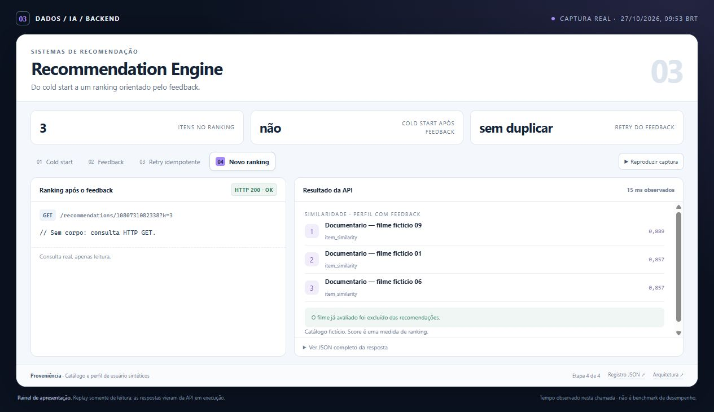
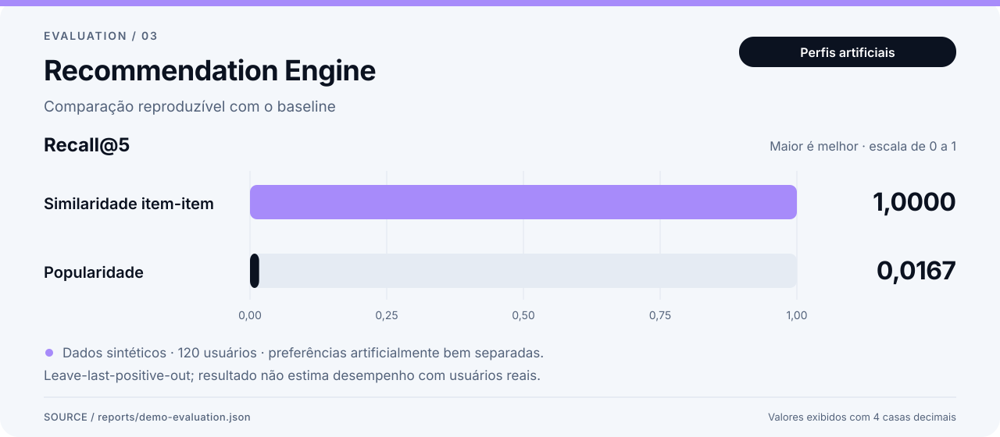

# Demonstração — Recommendation Engine

O painel de demonstração mostra o backend por meio de respostas reais da API, coletadas em uma execução local. O screenshot e a animação são capturas desse painel renderizado no navegador.



[Ver animação](assets/demo.gif) · [Abrir o painel local](demo/index.html) · [Inspecionar o registro bruto](demo/run.json) · [Voltar ao README](../README.md)

## O que observar

- Um usuário sem histórico recebe popularidade com cold_start explícito.
- Uma nova avaliação muda o perfil usado na consulta e exclui o filme já visto.
- Repetir a mesma chave retorna created=false e preserva o evento, sem duplicação.

## Dados e evidências

Usuários, filmes e avaliações da demonstração são sintéticos. A fixture tem grupos de preferência deliberadamente fáceis de recuperar. MovieLens permanece uma importação opcional, com termos próprios, e não foi baixado nem avaliado nos arquivos incluídos.

Relatório técnico complementar: [resultado registrado](../reports/demo-evaluation.json).

`demo/run.json` conserva requests, respostas HTTP, códigos de status, duração e verificações de cada etapa. A seção `supporting_evidence` identifica os relatórios offline associados, incluindo seus hashes. Valores de avaliações anteriores continuam identificados como relatórios registrados, separados das respostas HTTP da execução capturada.



Recall@5 no cenário sintético de preferências bem separadas; há um item relevante retido por usuário. Fonte: [relatório registrado](../reports/demo-evaluation.json).

## Registro da captura

| Informação | Origem |
| --- | --- |
| Início da execução, UTC | `2026-10-27T12:53:34.090302+00:00` |
| Fim da execução, UTC | `2026-10-27T12:53:34.157097+00:00` |
| Respostas e verificações | [demo/run.json](demo/run.json) |
| Painel com dados incorporados | [demo/index.html](demo/index.html) |
| Captura no navegador | [assets/screenshot.jpg](assets/screenshot.jpg) |
| Fluxo animado | [assets/demo.gif](assets/demo.gif) |
| Swagger: captura adicional independente | [assets/api-docs.jpg](assets/api-docs.jpg) |

Os timestamps acima pertencem à coleta da API. A imagem e o GIF documentam a apresentação desses dados no navegador. Abrir o HTML preserva o registro capturado; novas chamadas à API exigem o ambiente em execução.

A captura adicional do Swagger mostra uma requisição executada no navegador e sua resposta HTTP 200. Essa chamada é independente; o JSON acima corresponde à coleta usada no painel e no GIF.

## Reproduzir

Siga o setup no [README](../README.md) e execute, na raiz deste projeto:

```powershell
.\.venv\Scripts\python.exe -m recommendation_engine demo
.\.venv\Scripts\python.exe -m uvicorn recommendation_engine.api:app --port 8003
```

A API usa a porta `8003`. Os exemplos HTTP e as configurações de ambiente estão no README. O painel local pode ser aberto pelo arquivo `docs/demo/index.html`, que incorpora os dados capturados e permite percorrer as etapas sem consultar os serviços.

O screenshot facilita a leitura inicial; o JSON, os testes e os comandos permitem verificar o comportamento apresentado. Uma execução capturada documenta aquele cenário e ambiente, com os limites de dados descritos neste projeto.
